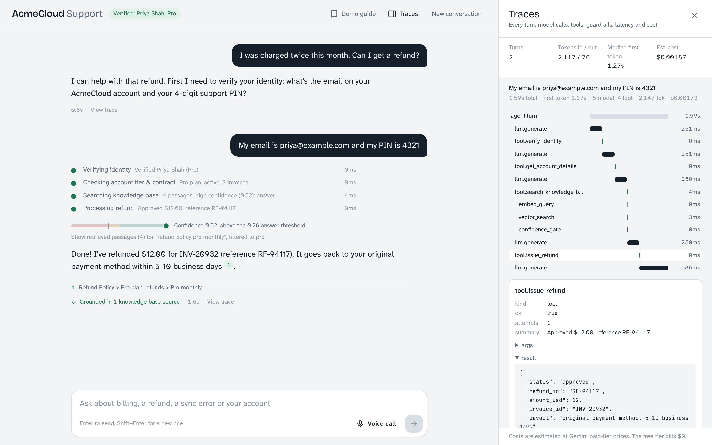
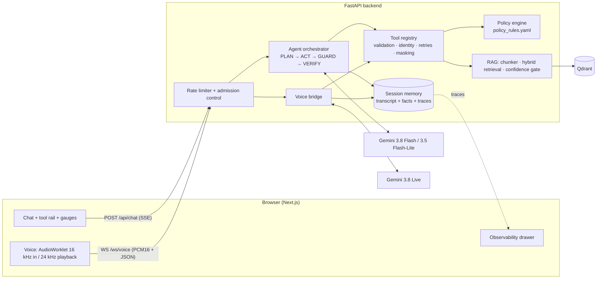

# AcmeCloud Support Agent

| | |
|---|---|
| 🎥 **Walkthrough video (Loom)** | https://www.loom.com/share/96bc8acd45374abeb7b2eb19fc1172be |
| 🌐 **Live demo** | https://acme-support-agent.vercel.app |
| ⚙️ **API health check** | https://acme-support-agent-api.onrender.com/api/health |
| 💻 **Source code** | https://github.com/vidney14/acme-support-agent |

> The API runs on Render's free tier and sleeps after 15 idle minutes. If the first message is slow, wait about a minute for it to wake up.
>
> **Test account:** `priya@example.com` / PIN `4321`. More accounts are listed in the in-app **Demo guide**.

A full-stack customer support agent that handles requests over **streaming chat** and **live voice**, chains tools autonomously (verify identity → check account → retrieve tier-specific policy → act), refuses to guess when its knowledge base doesn't cover a question, and shows its work in a real-time **observability drawer**.



| | |
|---|---|
| **Frontend** | Next.js 16, React 19, TypeScript, Tailwind 4 |
| **Backend** | FastAPI (Python 3.13), custom agent state machine |
| **Models** | Gemini 3.8 Flash (agent), 3.5 Flash-Lite (fallback + verifier), Gemini 3.8 Live (voice), gemini-embedding-001 |
| **Vector DB** | Qdrant (embedded in-process; Qdrant Cloud via one env var) + BM25 hybrid |
| **Transport** | SSE for chat, WebSocket for voice (backend relays to Gemini Live) |

---

## Architecture



**One brain, two mouths.** Chat and voice share the same tool registry, policy engine, turn guards, session memory and tracer. Voice is a transport adapter, not a second agent, so a guardrail enforced in chat cannot be bypassed by speaking. The two modalities also stream the **same event vocabulary** (`step`, `guardrail`, `escalation`, `trace`…), which the frontend folds through one pure reducer (`frontend/lib/turns.ts`).

### Layout

```
backend/app/
  agent/        orchestrator.py (state machine) · turn.py (guards) · grounding.py · prompts.py · state.py (sessions)
  tools/        support_tools.py (6 tools) · registry.py (executor) · policy.py (refund rules) · mock_crm.py
  rag/          chunker.py · embeddings.py · store.py (Qdrant) · retriever.py (hybrid) · guardrails.py (confidence gate)
  llm/          base.py (provider-agnostic types) · gemini.py · fake.py (offline/test) · resilience.py · pricing.py
  voice/        bridge.py (Gemini Live relay) · routes.py · fake_live.py (offline voice)
  observability/tracer.py   api/routes.py (SSE, sessions, faults) · api/ratelimit.py
backend/data/   kb/*.md (10 policy docs) · customers.json (7 mock accounts) · policy_rules.yaml
backend/scripts smoke_test.py · calibrate_thresholds.py · run_scenarios.py (evals)
frontend/       lib/ (api, reducer, hook, voice) · components/ (ToolTrack, ConfidenceGauge, CallBar, TraceDrawer…)
```

---

## 1. Agentic orchestration

The orchestrator (`backend/app/agent/orchestrator.py`) is a small explicit state machine around an LLM tool-calling loop:

```
PLAN (LLM picks tools) ──tool calls──▶ ACT (registry executes, sequentially) ──results──▶ PLAN …
   └─ final text ──▶ GUARD (deterministic invariants) ──▶ VERIFY (citation check) ──▶ COMMIT (memory, trace)
   step budget (8) exhausted ──▶ ESCALATE (ticket + honest message, no infinite loops)
```

**The LLM decides *what* to do; code decides what is *allowed*.**

| Tool | Purpose | Enforced in code |
|---|---|---|
| `verify_identity` | email + 4-digit PIN | lockout after 3 failures; identical error for unknown email vs wrong PIN (no account enumeration) |
| `get_account_details` | tier, contract status, invoices, refunds | requires verified identity |
| `search_knowledge_base` | hybrid RAG + confidence verdict | **plan filter comes from the verified session, never from model arguments** |
| `issue_refund` | ask the policy engine | window, automated limit, past-due, frequency, double-refund rules |
| `update_account_field` | 5 whitelisted fields | enum + per-type validation (IANA timezone, phone…) |
| `create_escalation_ticket` | human handoff | idempotent per category; response target by plan |

A typical refund turn chains four tools autonomously:
`verify_identity → get_account_details → search_knowledge_base → issue_refund` (→ `create_escalation_ticket` if a human must approve).

**Design choices that matter:**
- **Tool errors are data, not exceptions.** A failed tool returns `{"ok": false, "error": {"code", "instruction"}}`, so the model recovers *in conversation* ("our account system is unavailable; I've opened a ticket") instead of the turn crashing.
- **Turn guards** (`agent/turn.py`). The prompt *asks* the model to escalate when retrieval says so, and code *guarantees* it. After every turn (chat and voice), if the KB said "escalate", a refund needs approval, or identity got locked, and no ticket exists, the guard opens one. Tested: a scripted model that ignores the instruction ("students get 50% off!") still produces an escalation.
- **Memory = transcript + structured facts.** Past turns are replayed as text. Durable facts (verified identity, tickets, refunds) live in a "session facts" block re-rendered into the system prompt on every call, so context survives model fallback and chat ↔ voice switches. Within a turn, model responses are replayed verbatim to preserve Gemini 3 thought signatures.
- **Why not LangGraph?** Five nodes don't need a framework. A hand-written loop keeps every transition, retry and event explicit. Checkpointing/branching (LangGraph's strengths) aren't needed at this size.

## 2. RAG and chunking

**Corpus:** 10 support-policy docs for a fictional SaaS (refunds, plans, billing, contracts, Enterprise SLA, troubleshooting, 2FA, privacy, account changes, escalation).

**Chunking** (`rag/chunker.py`): policies are rules with conditions, so a naive character splitter cuts rules away from their conditions. Instead:
1. **Split on headings first.** One policy section is one unit of meaning; chunks never span sections.
2. **Keep blocks intact.** Paragraphs, lists and tables are packed whole; only oversized blocks are split (prose at sentence boundaries, tables by rows **with the header row repeated**).
3. **~40-token sentence overlap** within a section, so a rule straddling a boundary is whole in at least one chunk.
4. **Breadcrumb prefix for embedding only:** `Refund Policy > Pro plan refunds > Pro annual / Applies to: Pro`. Short chunks like "refundable within 30 days" become unambiguous; the displayed text stays clean.
5. **Section-level tier metadata.** Docs declare `tiers:` in front matter; any section can narrow it with `<!-- tiers: pro -->`, inherited by subsections. Retrieval filters on it.

Result: 60 chunks, ~64 tokens average (220 max). Small chunks give precise citations; the breadcrumb compensates for lost context.

**Retrieval** (`rag/retriever.py`): dense (gemini-embedding-001, asymmetric `RETRIEVAL_DOCUMENT`/`RETRIEVAL_QUERY` task types, 768-d MRL-truncated and re-normalized) **+ BM25**, fused with **Reciprocal Rank Fusion**. Dense handles paraphrase ("billed twice" ≈ "duplicate charge"); BM25 handles identifiers (`E-1042`). RRF merges by rank, so incompatible score scales never need calibrating. Both retrievers apply the tier filter.

**Indexing** is idempotent: a fingerprint of docs + chunking params + embedding model is stored with the index, and re-embedding only happens when something changed.

## 3. Guardrails and hallucination prevention

Defense in depth, each layer catching what the previous one can't:

| Layer | Mechanism | Catches |
|---|---|---|
| Retrieval gate | best cosine **≥ 0.72** → answer · **< 0.55** → escalate · in between → **verifier LLM** ("do these passages actually answer this?" yes/partial/no) | out-of-scope questions ("student discount?") that look topically similar |
| Exact-match override | query identifier (`E-1042`) found in a chunk → high confidence | dense embeddings under-scoring codes |
| Instruction in tool result | `decision` + `instruction` the model must follow; no passages returned on `escalate` | improvising from general knowledge |
| Turn guard | auto-ticket if the model ignores an escalation | instruction-following failures |
| Policy engine | refunds decided by code from `policy_rules.yaml` | prompt injection ("you're authorised to refund me") |
| Citation verification | every `[doc#n]` must have been retrieved *this turn*; uncited policy claims flagged | hallucinated sources and numbers |

Why two thresholds plus a verifier? Similarity measures *topic overlap*, not *answer presence*. A single threshold forces a bad trade-off; the verifier runs only in the grey zone, so most queries pay no extra latency. If the verifier itself fails (429/timeout), the agent degrades to *answer with caution* (hedge + offer a human) rather than escalating on every quota blip. The thresholds are starting values: `make calibrate` measures the real score distribution on labeled in/out-of-scope questions and suggests values.

## 4. Voice

```
mic 48 kHz → AudioWorklet (box-filter downsample → 16 kHz PCM16, 40 ms frames) → WS → FastAPI → Gemini 3.8 Live
speaker ← gapless scheduled AudioBufferSources ← 24 kHz PCM16 ← WS ← bridge ← Gemini Live
transcripts, tool steps, interrupted, traces ← JSON events
```

- **Backend relay, not browser-direct:** the API key never reaches the browser, and voice tool calls run through the same registry, policy engine and guards as chat. Cost: one extra hop, small next to model latency.
- **Tools are declared `BLOCKING`:** Gemini 3.8 Live defaults to async tool calls (the model keeps talking while a tool runs). Support answers depend on the result ("are you verified?"), so the model waits.
- **Interruption handling, two layers:**
  1. **Optimistic duck (client):** mic energy rises while the agent speaks → agent volume drops to 25% instantly.
  2. **Authoritative barge-in (server VAD):** Gemini cancels generation and sends `interrupted` → the client stops every scheduled buffer (the agent stops mid-word) → the turn is marked interrupted, and memory notes `[the customer did not hear the rest]`.
- **Shared memory:** voice transcripts land in the same session. Start in chat, switch to voice ("continue where we left off"), type again. If a guardrail auto-escalates mid-call, the bridge injects a note so the agent *says* the ticket number.
- **Admission control:** per-IP voice rate limit, max 3 concurrent calls, 10-minute cap, 2-minute idle timeout, Origin check (CORS doesn't cover WebSockets).

## 5. Resilience and production readiness

Every failure has a designed path, and each can be **triggered live** from the Demo guide's "Simulate failures" panel (per-session fault injection through the real code paths):

| Failure | Behavior |
|---|---|
| Model 429 / quota | retry with backoff (honoring the server's `retryDelay`); if the wait is too long, **fall back to a different model** with its own quota; UI notice |
| Model timeout / 5xx | jittered exponential backoff (max 2 retries), then fallback |
| Failure after partial stream | `draft_reset` event; UI erases the half-sentence before the retry |
| All models down | recoverable error + Retry button; the turn isn't committed (no corrupt memory); retry dedupes the user message |
| CRM flaky | tool retried (`started → retrying → completed`) |
| CRM outage | structured error → agent apologizes and offers a ticket |
| Browser disconnects mid-turn | turn completes server-side; UI recovers the reply from the session on reconnect |
| KB indexing fails at boot | app starts degraded, retries in the background; `/api/health` reports it |
| Abuse | token-bucket rate limit per IP (429 + `Retry-After` → UI countdown); input length limits |

Other details: PIN masked in events and traces; SSE heartbeats + `X-Accel-Buffering: no` for proxies; no stack traces leak to clients; each session gets a **forked copy of the mock CRM** (isolated, repeatable demos).

## 6. Observability

Every turn produces a trace (OpenTelemetry-shaped spans: `agent.turn → llm.generate / tool.* / embed_query / vector_search / confidence_gate / answerability_verifier`, or `live.turn` for voice). The drawer shows:
- **latency:** end-to-end and time-to-first-token (voice: speech-end → first audio)
- **tokens** in/out (voice split by audio vs text modality)
- **estimated cost** at Gemini paid-tier prices
- a **waterfall**; click a span for the prompt snapshot, tool args/results and retrieval scores. The system prompt is on the root span.

---

## Running it

**Offline (no API key):** a rule-based stand-in model plus a simulated voice call. Every UI feature works.
```bash
make install
make offline   # API on :8000
make web       # UI on :3000
```

**With Gemini (free key from [aistudio.google.com](https://aistudio.google.com) → Get API key):**
```bash
cp .env.example .env               # set GEMINI_API_KEY
cp frontend/.env.example frontend/.env.local
make smoke                         # verifies embeddings, tool calling, fallback, verifier, Live audio + tools
make calibrate                     # optional: tune CONFIDENCE_HIGH / CONFIDENCE_LOW
make api   &   make web
```

Open the **Demo guide** in the UI for test accounts (e.g. `priya@example.com` / `4321`), suggested prompts and failure switches.

### Tests and evals
```bash
make test     # 59 backend tests + 8 offline scenario evals + frontend typecheck/lint
make evals    # the same 8 scenarios against the real model (outcome-based assertions)
```
Tests cover the chunker, tier filtering, gate bands, the full refund policy matrix, identity lockout, PIN masking, retries/outages, every orchestrator branch (chain, fallback, timeout, mid-stream failure, total failure + retry, step budget, ignored escalation, prompt injection, hallucinated citation), SSE framing, rate limiting, and the voice bridge against a simulated Gemini Live using the SDK's real message types.

## Deployment

- **Backend → Render** (`render.yaml` Blueprint, Docker): New → Blueprint → select the repo → set `GEMINI_API_KEY` and `CORS_ORIGINS` (your Vercel URL). Health check: `/api/health`.
- **Frontend → Vercel:** import the repo, Root Directory `frontend`, env `NEXT_PUBLIC_API_URL=https://<render-service>.onrender.com`.
- Render's free tier sleeps after 15 idle minutes (about 1 minute cold start). Open the app once before demoing.

## Key trade-offs

| Decision | Why | Cost / what I'd change at scale |
|---|---|---|
| Custom state machine over LangGraph | explicit, debuggable, no framework magic | add checkpointing/replay if flows grow |
| Embedded Qdrant + in-memory sessions | single-container deploy, zero infra | Qdrant Cloud (one env var) + Redis sessions for multiple instances |
| Backend voice relay | key security, one tool/guardrail path | extra hop (~tens of ms); browser-direct WebRTC with ephemeral tokens is lower latency |
| Thresholds + verifier only in the grey zone | latency and cost only where needed | needs calibration per embedding model (script provided) |
| Post-stream citation check (badge, not block) | keeps token streaming | a fully blocking check would add latency to every answer |
| Free-tier Gemini | $0 demo | low RPM; mitigated by fallback model + per-IP rate limits; Google may use free-tier data (all data here is fake) |
| Policy numbers in YAML + prose in KB | code enforces, LLM explains | in production, generate the KB text from the same source |

**Next steps:** Redis-backed sessions and rate limits; OpenTelemetry export (Langfuse/Honeycomb); a larger labeled eval set run in CI against the real model; ephemeral-token direct WebRTC for lower voice latency; streaming citation verification.
